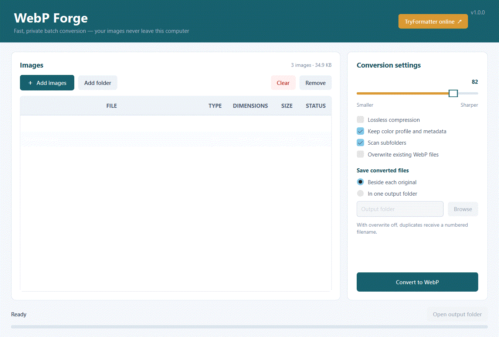

# WebP Forge

A private Windows desktop utility for converting many images to WebP at once. Images are processed locally and never uploaded.

**Current version:** 1.1.0

[](https://github.com/Tryformatter/builk-image-to-webp/releases)



Convert a batch of images locally: add files or a folder, adjust quality, and click **Convert to WebP**.

## Recommended improvement order

1. **Code signing** — sign the Windows executable with a trusted Authenticode certificate to reduce SmartScreen warnings.
2. **Image safety limits** — protect against oversized, malformed, or decompression-bomb images with file-size and pixel-count validation.
3. **Tests** — expand coverage for corrupt files, read-only folders, Unicode paths, cancellation, GIFs, metadata, and output collisions.
4. **Workflow hardening** — pin GitHub Actions to commit SHAs and use the minimum required workflow permissions.
5. **UX improvements** — add clearer per-file results, remembered settings, keyboard shortcuts, and an output-folder reveal action.

Prefer the browser? Use the branded
[TryFormatter Image to WebP converter](https://www.tryformatter.com/image/image-to-webp)
with no software installation and no file upload. Processing stays in your browser.

## About TryFormatter

WebP Forge is part of [TryFormatter](https://www.tryformatter.com), a collection of focused tools for files, code, images, PDFs, SEO, security, calculations, and everyday tasks.

TryFormatter is designed around clear workflows, quick access, browser-first processing where applicable, and privacy-conscious handling of user input. Explore the [full tool collection](https://www.tryformatter.com/all-tools), read [About TryFormatter](https://www.tryformatter.com/about), or [contact the team](https://www.tryformatter.com/contact).

## Features

- Add individual images or scan entire folders
- Drag and drop images or folders into the app
- JPG, JPEG, PNG, BMP, TIFF, and GIF input
- Lossy quality control or lossless WebP
- Preserves transparency and optional metadata/color profiles
- Choose an output folder or save beside originals
- Collision-safe output naming and optional overwrite
- Responsive progress display with cancellation
- Explicit table text colors for reliable visibility across Windows themes
- About TryFormatter link in the app header

## Run from source

```powershell
python -m pip install -r requirements.txt
python app.py
```

## Build the Windows executable

```powershell
.\build.ps1
```

The standalone executable is created at `dist\WebP-Forge.exe`.

## Download a GitHub Actions build

Every push to `main` creates a tested Windows executable. Open the repository's
**Actions** tab, select the latest **Build Windows executable** run, and download
the `WebP-Forge-windows-x64` artifact.

Successful pushes to `main` also publish `WebP-Forge.exe` automatically on the
[GitHub Releases page](https://github.com/Tryformatter/builk-image-to-webp/releases).
The **Downloads** badge at the top of this page shows the total number of
GitHub release-asset downloads. It counts downloads from GitHub Releases only;
Actions artifacts and other distribution channels are not included.

### Windows security warning

Windows may show **“Windows protected your PC”** for a newly downloaded
executable when it has not yet built reputation or does not have an Authenticode
code-signing certificate. This is a reputation warning, not proof that the app
is unsafe. Download only from the official [Releases page](https://github.com/Tryformatter/builk-image-to-webp/releases),
check the release asset name, and scan the file with Windows Security before
running it. If you trust the source, select **More info → Run anyway**.

For stronger protection and fewer warnings, future releases should be signed
with an Authenticode certificate and publish the certificate fingerprint and
SHA-256 checksum alongside the executable. Do not disable Microsoft Defender
or SmartScreen globally.

Note: animated GIFs are converted using their first frame.
